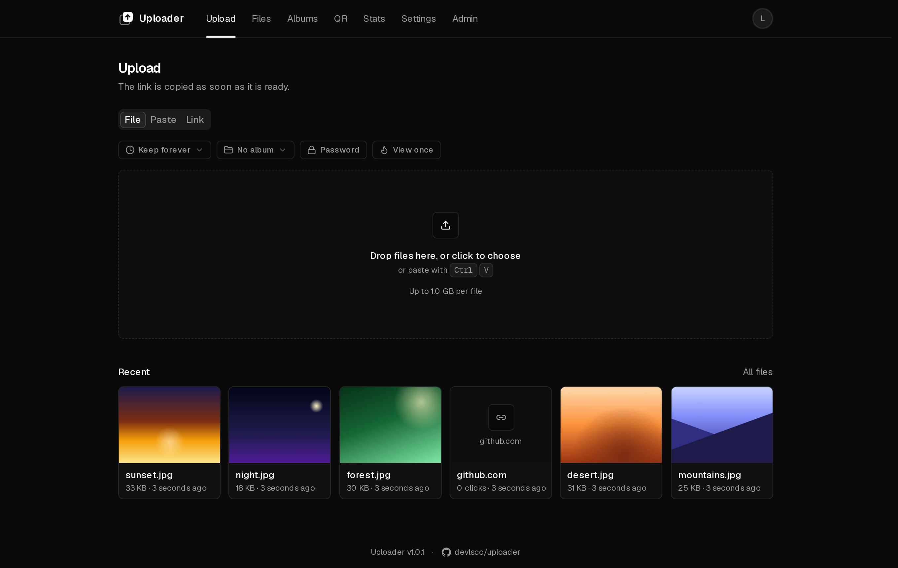
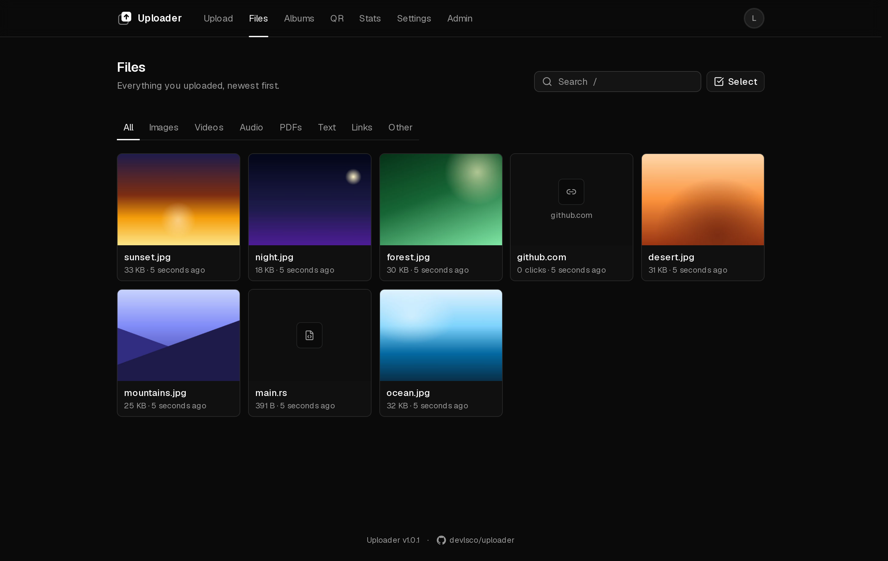
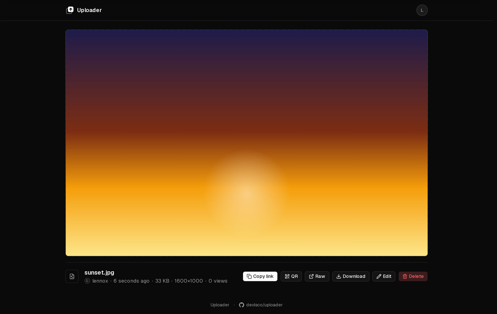
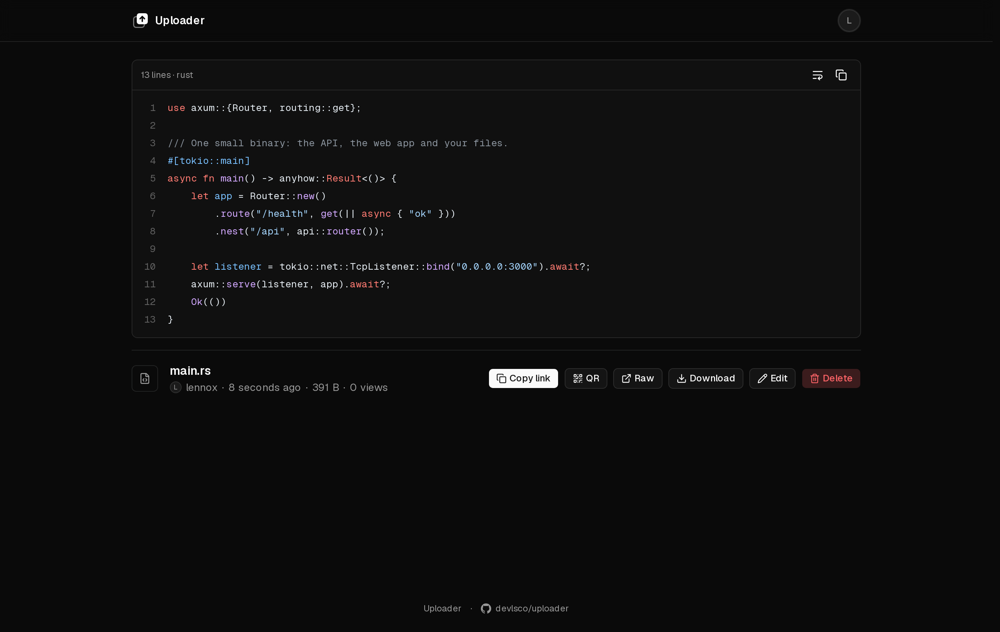
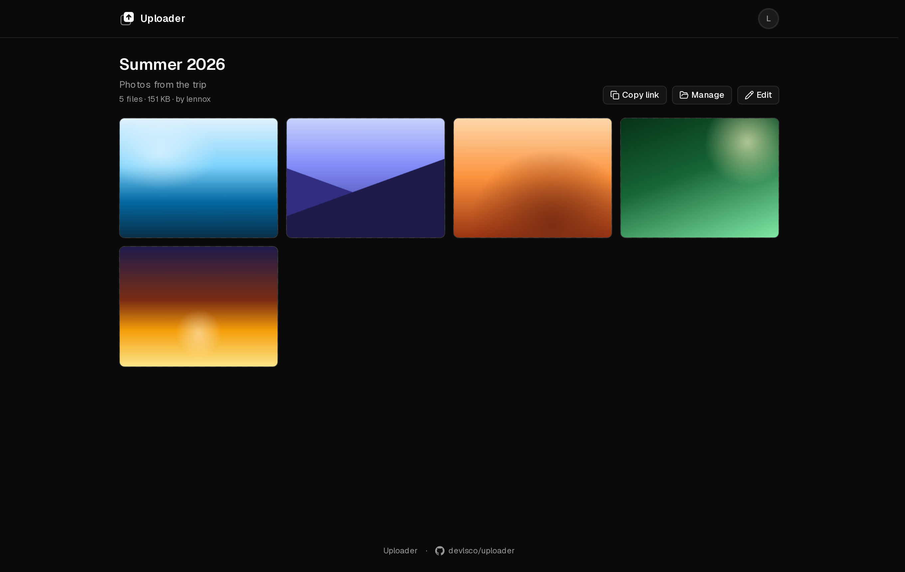

<p align="center">
  
</p>

<h1 align="center">Uploader</h1>

<p align="center">Your own place for screenshots, files, text and short links.</p>

<p align="center">
  <a href="https://github.com/devlsco/uploader/releases/latest"></a>
  <a href="LICENSE"></a>
</p>

<p align="center"></p>

## Features

- Upload files, screenshots, text and short links
- Previews in Discord, Twitter and Chatterino
- Passwords, expiry and view-once files
- Albums, search, stats and QR codes
- ShareX and Chatterino in one click
- Invite friends, log in with Twitch

## Install

You need a server with [Docker](https://docs.docker.com/get-docker/).

```sh
mkdir uploader && cd uploader
curl -O https://raw.githubusercontent.com/devlsco/uploader/main/docker-compose.yml
docker compose up -d
docker compose logs uploader
```

Open the setup link from the log and create your account. Done.

Using a domain? Set `UPLOADER_URL` in `docker-compose.yml`.

## Update

```sh
docker compose pull && docker compose up -d
```

## Screenshots

| | |
| --- | --- |
|  |  |
|  |  |

<details>
<summary>Without Docker</summary>
<br>

Grab a binary from the [releases](https://github.com/devlsco/uploader/releases) and run it:

```sh
chmod +x uploader-linux-x86_64
UPLOADER_URL=https://up.example.com ./uploader-linux-x86_64
```

A systemd unit is in [`deploy/uploader.service`](deploy/uploader.service). Updates work from the admin panel.

| Setting | Default | |
| --- | --- | --- |
| `UPLOADER_URL` | `http://localhost:3000` | Public address |
| `UPLOADER_BIND` | `0.0.0.0:3000` | Listen address |
| `UPLOADER_DATA` | `./data` | Database and files |
| `UPLOADER_TRUST_PROXY` | `false` | `true` behind a proxy, `cloudflare` for CF-Connecting-IP |

</details>

<details>
<summary>API</summary>
<br>

```sh
curl -H "Authorization: Bearer $KEY" -F file=@cat.png https://up.example.com/api/upload
```

Options: `?expires=7d`, `?burn=1`, `?max_views=10`, `?album=<id>`, `X-Password` header.

</details>

## License

MIT. Inspired by [Nerixyz/uploader](https://github.com/Nerixyz/uploader).
